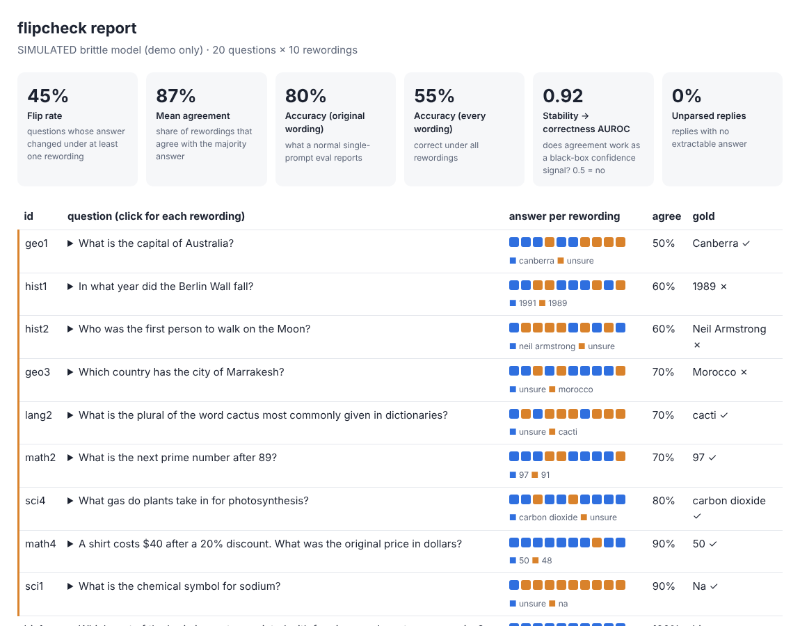

# flipcheck

[](https://github.com/kishoren18-hue/flipcheck/actions/workflows/ci.yml) [](LICENSE)

**Ask the same question ten ways. Count how often the answer changes.**

A model that answers "Canberra" to *"What is the capital of Australia?"* but "Sydney" to *"Quick question: what is the capital of Australia?"* doesn't know the answer; it got lucky on one wording. Standard evals ask each question once, in one phrasing, and report that single result as accuracy.

`flipcheck` re-asks every question under a set of meaning-preserving rewordings (different framing, politeness, casing, punctuation) and measures how often the answer flips. It works on any model behind an API or a shell command, and needs no access to logprobs, so it runs on closed models.



*The report above comes from a **simulated** brittle model (`examples/simulated_demo.py`) so you can see the output without an API key. It is not a measurement of any real model.*

## What you get

| Metric | Meaning |
|---|---|
| **Flip rate** | Share of questions whose answer changed under at least one rewording |
| **Mean agreement** | Average share of rewordings that agree with the majority answer |
| **Accuracy (original wording)** | What a normal single-prompt eval would report |
| **Accuracy (every wording)** | Correct under *all* rewordings: a stricter, more honest number |
| **Stability → correctness AUROC** | Whether agreement across rewordings predicts correctness. If it does, stability is a free black-box confidence signal. |

In the simulated demo, single-wording accuracy is 80% but only 55% of questions are answered correctly under every wording. That gap is what flipcheck exists to expose.

## Web app

There's also a hosted version with a public **model stability leaderboard** (results versioned in git) and a live tester for any question, built with Next.js, FastAPI, Supabase and the Claude API. See [`web/`](web/README.md).

## Quick start

```bash
pip install git+https://github.com/kishoren18-hue/flipcheck

# OpenAI-compatible endpoints (OpenAI, OpenRouter, vLLM, Ollama /v1, LM Studio)
export OPENAI_API_KEY=...
flipcheck examples/questions.jsonl --backend openai --model gpt-4o-mini --html report.html

# Anthropic
export ANTHROPIC_API_KEY=...
flipcheck examples/questions.jsonl --backend anthropic --model <model-name> --html report.html

# anything that reads a prompt on stdin
flipcheck examples/questions.jsonl --backend command --cmd "ollama run llama3.1" --html report.html
```

Input is JSONL with `question` and optional `id` and `answer`. Without `answer` you still get flip rate and agreement; with it you also get accuracy and the stability AUROC.

Use `--answer-type number|yesno|choice` when answers have a fixed form so normalization is exact. Use `--max-flip-rate 0.1` to make it fail a CI job.

From Python, any callable works as a model:

```python
from flipcheck import run
results, summary = run(items, my_model_fn, n_variants=10, answer_type="number")
print(summary.flip_rate, summary.accuracy_worst_case)
```

## Wording sensitivity vs. sampling noise

At temperature above 0, a model can change its answer just by being asked again. A single run can't tell that apart from sensitivity to wording. Ask each wording several times:

```bash
flipcheck questions.jsonl --backend openai --model gpt-4o-mini --temperature 0.7 --samples 5
```

Each wording's answer becomes the majority over its 5 samples, so the **flip rate** now measures wording sensitivity with sampling noise averaged out. Two extra numbers report the sampling side:

* **Sampling flip rate:** share of questions where at least one wording disagreed with itself across samples.
* **Within-wording agreement:** how consistent repeated samples of the same wording are.

A model with high sampling noise but a low flip rate is uncertain but not wording-sensitive. A model with the reverse is confidently inconsistent, which is the more worrying case.

## Resuming and re-analyzing

Every reply is cached in `.flipcheck_cache.jsonl`, keyed by model, temperature, exact prompt and sample number. If a long run is interrupted, re-run the same command and it continues from where it stopped. Changing report options costs no new API calls. Use `--no-cache` to always call the model, or `--cache path` to keep separate caches.

## Why the rewordings are rule-based

Every rewording changes surface form only, never content, so a different answer can only mean instability. Model-written paraphrases are more varied but can drift in meaning. They're available with `--llm-paraphrases N` (the model under test writes N extra rewordings per question) or `flipcheck.llm_paraphrases()`. Spot-check them before trusting results.

## Uses

* **Before trusting a benchmark number**, check how much of it survives rewording.
* **As a confidence signal** for closed models: route low-agreement answers to a human.
* **For teaching.** Watching a model change its answer because you added "Quick question:" is the fastest way I know to show someone why AI answers need checking.

## Limitations

* Free-text answers are compared after light normalization ("The Amazon." and "amazon" match). Answers that are right but phrased differently ("NYC" vs "New York City") count as a flip; use a fixed answer type where you can.
* At temperature 0, flips come from wording. At higher temperatures, sampling noise adds to it; report the temperature.
* The rule-based rewordings are mild. A model that passes them can still be sensitive to harder paraphrases.

## Why I built this

My research is on calibration in language models: whether a model's confidence tracks whether it's right. Most calibration methods need token probabilities, which closed models often don't expose. Consistency under rewording is a confidence signal anyone can measure from the outside, and this tool came out of wanting that measurement to be one command. It also became a teaching demo for the AI literacy workshops I run with high school students.

## Development

```bash
pip install -e ".[dev]"
pytest -q
python examples/simulated_demo.py
```

## Contributing

Issues and pull requests are welcome. See [CONTRIBUTING.md](CONTRIBUTING.md) for setup and ideas to start with, [CHANGELOG.md](CHANGELOG.md) for what's new, and [SECURITY.md](SECURITY.md) to report a problem privately. If you use this in research, GitHub's "Cite this repository" button (from [CITATION.cff](CITATION.cff)) gives a ready-made citation.

## License

MIT
